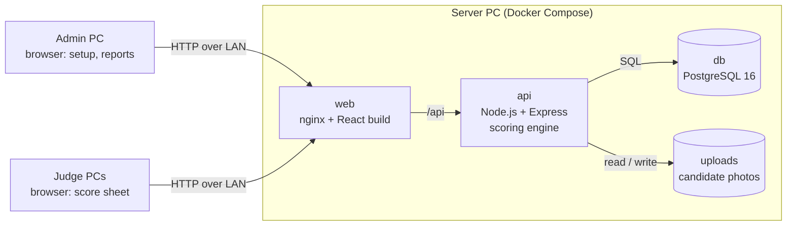

# ACLC Ormoc Tabulation System PRD

Product requirements for the ACLC College of Ormoc City tabulation system (the software is called Tally). Last updated Oct 25, 2026.

## Overview

The ACLC Ormoc Tabulation System is the school's web app for scoring its pageants and contests: judges score candidates from their own PCs and the admin gets final rankings right after the last score is in. It replaces hand tallies and shared spreadsheets, where math errors and late results are the usual problems. It runs every ACLC Ormoc event, not one pageant: each event configures its own rounds, cut-offs, candidate groups, criteria and scoring method, with no code changes. The school's seal, name and colour are set once and brand every screen and printout. The flow stays simple: judges input scores, the system calculates, the admin shows the report.

**Goals**

- Judges enter scores by category from any client PC on the venue network.
- The admin sets up an event, its candidates, categories, criteria and judges in minutes, including bulk import from CSV or Excel.
- Rankings (Champion, 1st, 2nd and 3rd runner-up, and optional lower ranks) are computed automatically, overall or split by a group such as Type, House or Level.
- Score sheets stay responsive with 100 or more candidates.

**Non-goals (v1)**

- Public audience voting or live public scoreboard.
- Internet hosting; the system runs on a local server PC.
- Payments, ticketing or candidate self-registration.

**What keeps it general across events.** Anything specific to one event is either an admin setting for that event (its rounds, cuts, criteria, groups) or handled on paper by the organizers (eligibility, permits, deductions). It is never written into the code. The test for any new request: would a different pageant need it, set up differently? Then it is a setting. Does it only make sense for one pageant? Then it stays on paper.

## Example configuration: Hara ng ACLC Ormoc 2026

*Hara ng ACLC Ormoc: Queen of All Nations 2026* is one pageant event, the first run on the system, and a good test of the general design: it uses elimination rounds, candidate groups and a pair-vote round. It is held in celebration of United Nations Month, on the theme "Breaking Barriers, Embracing Diversity, and Celebrating the Beauty of Authenticity, Equality, and Pride Across All Nations". Everything below is set up for this event by the Admin as data; none of it is built in.

**Candidates.** Each House enters 20 candidates: 10 from Senior High School and 10 from College. In the system, House and Level are just two admin-defined candidate groups; another pageant might group by Barangay or School, or not at all.

| Round | Who competes | Basis for the next cut |
| --- | --- | --- |
| 1. Production Number (National Costume) | All candidates | Top 20 advance |
| 2. One Minute Speech (advocacy speech, in national costume) | Top 20 | Top 10 advance |
| 3. Gown Competition | Top 10 | Scored |
| 4. Deba Teh (Debate Challenge) | Top 10, in pairs | Judges vote per pair (the guidelines' raised hands); pairs are set by rank or by random draw, which covers the element of chance in guideline 8; pair winner picks their position first in the next debate round; overall performance decides the Top 5 |
| 5. Witty Questions (Q&A) | Top 5 | Decides the Top 3 Super Finalists |
| 6. Final Question | Top 3 | Final ranking: Champion, 1st and 2nd Runner-up |

**Deductions.** Guideline 13 takes 5 points off for breaking guideline 7, applied to the total raw score after tabulation and before the Top 3 are announced. The organizers apply this on paper; it is not entered in the system, so a disputed deduction never changes a stored score.

**Event rules handled by the organizers, not the system**

| Guideline | Rule | Who checks it |
| --- | --- | --- |
| 1 | Candidates are bona fide students of ACLC College of Ormoc City, enrolled for SY 2025-2026, verified through the School Registrar | Organizers, before the event |
| 2 | Candidates are members of the LGBTQIA+ community who identify as gay or as transgender women | Organizers, before the event |
| 3 | A parent's permit for every candidate, especially Senior High School candidates | Organizers, before the event |
| 9 | A one-minute advocacy speech in the assigned national costume, on the event theme | Judges score it in One Minute Speech |
| 13 | 5-point deduction for breaking guideline 7 | Organizers, on paper |

**Differences between the guideline pages.** The rationale lists the segments as Production Number, Opening Speech, Formal Wear, Deba Teh, Witty Question and a Final Q&A for the Top 3, numbered 1, 2, 3, 4, 6, 6. The exposure list names them One Minute Speech and Gown Competition, with Witty Questions for the Top 5 and the Final Question for the Top 3. The system follows the exposure list; the organizers should confirm it.

**General features this example needs (all configurable per event)**

- Any number of rounds, each with an optional Top N cut-off that decides who appears on the next round's score sheet.
- Admin-defined candidate groups (e.g. House, Level, Type), with rankings filterable or split by any group.
- A judging type per round: criteria points, or pair vote (as in Deba Teh).
- Reports with each round's scores, the overall ranking and the titles.

## Users and roles

Two roles exist: the Admin runs the event and sees all results; a Judge only scores candidates in the categories assigned to them.

| Capability | Admin | Judge |
| --- | --- | --- |
| Log in | Yes | Yes (username = judge name, password set by Admin) |
| Events, candidates, groups, rounds, criteria, judges | Yes | No |
| Bulk import of candidates and photos | Yes | No |
| Choose which rounds each judge scores | Yes | No |
| Score candidates | No | Yes, in the rounds assigned to them |
| View reports | Yes | No (own submitted scores only) |
| Testing mode, Start over, Go live, Finish event | Yes | No |
| Auto-input shortcuts | No | Yes, only while testing mode is on |

## System architecture

The app is web-based: Admin and Judge PCs open it in a browser over the venue LAN, and one server PC runs the app, the PostgreSQL database and picture storage.



**Stack.** React (Vite + TypeScript) frontend, Node.js (Express, TypeScript) REST API with Prisma, PostgreSQL 16, SheetJS for CSV/Excel import and export, JSZip for photo ZIPs. One language end to end keeps the codebase simple. Clients reach the server by its LAN IP, e.g. `http://192.168.1.10`.

**Deployment: Docker Compose on the server PC.**

| Service | Image | Role |
| --- | --- | --- |
| web | nginx + React production build | Serves the UI on port 80, proxies `/api` to the API |
| api | Node.js app | Business logic, scoring engine, file uploads |
| db | postgres:16 | Data, on a named volume |

- Named volumes for PostgreSQL data and candidate pictures, so data survives restarts and rebuilds.
- `restart: unless-stopped` on every service, so the stack comes back after a reboot.
- Images are pulled or built before event day; the venue needs no internet.
- Scheduled `pg_dump` to a mounted backup folder, and a manual backup command for before and after the show.
- Windows server PC: Docker Desktop with WSL2, and port 80 allowed in Windows Firewall.

## Data model

Everything belongs to an Event; a score is one judge's points for one candidate on one criterion. The diagram is in the [README](../README.md#database); the full schema is [`apps/api/prisma/schema.prisma`](../apps/api/prisma/schema.prisma).

| Entity | Key fields | Notes |
| --- | --- | --- |
| Event | name, date, venue, status (setting up / live / finished), testing mode | Top-level container; one live event at a time |
| Group, GroupValue | name | Admin-defined groupings such as Type, House or Level, and their values |
| Candidate | number, name, picture, group values | Number unique per event |
| Round | order, name, kind (scored or pair vote), Top N, score method, status | The stages of the event |
| RoundEntry | round, candidate, advanced, score, rank | Who is in a round; filled with results when it closes |
| Category, Criterion | name, weight; min and max points | What judges score inside a round |
| Judge, JudgeCategory | name (= username), password hash; assigned categories | Password set by the Admin, stored hashed |
| Score | judge, candidate, criterion, points, draft or submitted, test flag | Unique on (judge, candidate, criterion) |
| Pair, PairVote | two candidates; judge's chosen winner | For pair-vote rounds such as Deba Teh |
| AuditLog | actor, action, details | Opening, closing, resets, imports |

**Scoring rule.** Each judge's total for a candidate is out of 100: each criterion's points over its max, times its weight, summed. A candidate's round score is the average of the judges' totals. Other methods are chosen per round (see Scoring methods). Points outside a criterion's min-max are rejected.

## Scoring methods

There is no official tabulation standard, so the Admin picks the scoring rules for each round from the common options below; the event's guidelines decide which.

| Setting | Options | Default |
| --- | --- | --- |
| Score method | Average of raw scores · Rank-sum · Pair vote | Average of raw scores |
| Criterion weights | Percent of its category, must total 100% | Equal |
| Category weights | Percent of the round, must total 100% | Equal |
| Carry-over | Start fresh · Carry a share of earlier rounds (e.g. 30% earlier + 70% this round) | Start fresh |
| Drop extremes | Off · Drop highest and lowest judge score (needs 5+ judges) | Off |
| Tie-break | Shared rank · Higher score in a chosen category · Higher count of judges' first places · Admin decides | Shared rank |

To keep setup simple, a round's form shows only its name, judging type and Top N. These settings sit under More settings for the events that need them.

**Average of raw scores.** Each judge's points are summed per candidate, then averaged across judges; highest wins.

**Rank-sum.** Each judge's scores are turned into ranks (1 = best), the ranks are added, and the lowest total wins. This keeps one generous or harsh judge from swinging the result.

| Candidate | Judge 1 | Judge 2 | Judge 3 | Average | Rank-sum |
| --- | --- | --- | --- | --- | --- |
| A | 95 (rank 1) | 80 (rank 2) | 82 (rank 2) | 85.7, wins | 5 |
| B | 85 (rank 2) | 86 (rank 1) | 85 (rank 1) | 85.3 | 4, wins |

One high score from Judge 1 wins it for A under averaging; under rank-sum, B wins because two of three judges preferred B.

**Carry-over.** With carry-over on, a round's final score is:

```text
final = w * earlier rounds + (1 - w) * this round
```

where w is the carry-over share set by the Admin.

Every report labels which method and weights were used, so results can be explained to contestants.

## Functional requirements

**FR-1 Authentication**

1. Separate login for Admin and Judge on one login page; role decides the landing screen.
2. Judge username = judge name; password set manually by the Admin and changeable by the Admin.
3. Passwords stored hashed (bcrypt); sessions expire after inactivity; Judge pages reject Admin-only routes server-side.

**FR-2 Admin management**

1. Events: create, edit, delete, go live or finish; only one live event at a time.
2. Candidates: number, name, groups, picture upload (JPG, PNG or WebP, resized to a thumbnail on upload).
3. Rounds, categories and their criteria, each criterion with min and max points and a weight.
4. Judges: create with name and password, and choose which rounds each one scores.
5. Deleting an item that already has scores asks for confirmation and says what will be removed.

**FR-3 Bulk import**

1. Import candidates from CSV or Excel (.xlsx), with a column per group.
2. Downloadable template with the event's own columns, e.g. `Number, Name, House, Level, Photo file`.
3. Pictures can be uploaded as a ZIP matched by the photo column, by number (`12.jpg`) or by name.
4. Preview before saving: new rows, updates to existing numbers, rows with errors (missing name, bad or duplicate number) and new group values.

**FR-4 Judge scoring**

1. Judge sees the open round's candidate list with picture, number, name and one input per criterion.
2. Inputs accept only numbers within the criterion's min-max; invalid values are highlighted.
3. Scores auto-save as drafts; the judge submits the category once all candidates are scored.
4. After submit, scores are locked; only the Admin can let the judge change them.
5. Progress shows scores entered against the total needed.

**FR-5 Rounds and eliminations**

1. An event has ordered rounds; each round has its own categories and criteria and a cut-off (Top N advance).
2. When the Admin closes a round, the system ranks candidates and shows the Top N with a tie warning at the cut line.
3. The Admin confirms whether everyone tied at the cut goes on; only advancing candidates appear on the next round's score sheet.
4. The Admin sets per round whether earlier round scores carry over or the next round starts from zero.
5. A round can be a pair-vote round (Deba Teh): the Admin sets pairs, each judge picks one winner per pair, and the screen shows the vote tally live.

**FR-6 Event status and rehearsals**

1. The Admin sets an event Live with Go live; judges can log in only to the live event, and only one event can be live at a time. Finish event locks judges out and keeps every result.
2. Start over (testing mode only) deletes every score, vote and round result so a rehearsal starts clean; candidates, rounds and judges stay.
3. Deductions are not entered in the system. The organizers apply them on paper, so a disputed deduction never changes a stored score.

## Reports and rankings

The Admin can view any report at any time, print it and export it to Excel; rankings recompute as each score is submitted.

| Report | Shows | Filters |
| --- | --- | --- |
| Overall ranking | Final place, title, furthest round reached, rank and score there | Any group value |
| By round | Each candidate's category scores, round score, rank and whether they went on | Round, any group value |
| By candidate | One candidate's points per criterion, per judge, in every round | Candidate |
| By judge | Every score a judge gave in a round, with totals | Judge, round |

**Rank titles.** Rank 1 = Champion, 2 = 1st Runner-up, 3 = 2nd Runner-up, 4 = 3rd Runner-up, shown once the final round closes.

**Separate by group.** Rankings can be computed per type or any other candidate group (a Champion for each House or Level) or across everyone together.

**Ties.** Equal totals share a rank by default; at a cut the Admin decides whether all tied candidates go on.

**Outputs.** Printable result sheets with signature lines for the judges and the tabulator, and Excel export.

## Extra features

Testing mode lets the Admin rehearse with fake scores, then wipe them before the real contest.

**Admin: Testing mode**

1. Toggle per event; a "Testing mode on" badge shows on every Admin and Judge screen.
2. Scores entered while it is on are flagged as test scores and excluded from final reports once it is off.

**Admin: Start over and corrections**

1. Start over clears every score and vote after a rehearsal (testing mode only), and is written to the audit log.
2. If a judge submitted a wrong score, the Admin presses Allow changes; the judge fixes it and submits again.

**Judge: Auto-input shortcuts (testing mode only)**

| Shortcut | Action |
| --- | --- |
| Shift + J | Fill every empty criterion on the current page with a random value within its min-max |
| Shift + P | Fill every criterion on the current page with its max points (perfect score) |

Shortcuts are disabled outside testing mode so a real score can't be filled by accident.

## Performance: 100+ candidates

The judge score sheet must stay smooth with 100 candidates × several criteria, which is 500+ inputs and 100 pictures.

| Technique | Where | How |
| --- | --- | --- |
| Pagination | Judge score sheet, Admin lists | 10, 20, 50 or 100 per page; drafts auto-save when the page changes |
| Lazy-loaded thumbnails | All candidate lists | `loading="lazy"`, 160 px WebP thumbnails generated on upload |
| Long image cache | Candidate photos | File names change on every upload, so browsers keep them for 30 days |
| Server-side paging and indexes | API, PostgreSQL | Paged queries; indexes on event, candidate and judge |
| Debounced auto-save | Score inputs | Save once per 500 ms of idle time, not on every keystroke |
| Memoized rows | Judge score sheet | Typing in one input re-renders that row only |

**Targets.** Score sheet page loads in under 1 second on the LAN; typing in an input shows no visible delay; 10 judges saving at once complete in under 500 ms each.

## Non-functional requirements

| Area | Requirement |
| --- | --- |
| Availability | Runs offline on the venue LAN; no internet needed during the event |
| Concurrency | At least 15 judges scoring at once with no lost or duplicated scores |
| Data safety | Every score is saved in a PostgreSQL transaction; backups before and after the event |
| Security | Hashed passwords, role checks on every API route, Admin actions logged |
| Browsers | Latest Chrome, Edge and Firefox; desktop and tablet widths |
| Usability | A judge can score one candidate on all criteria using only the keyboard (Tab / Enter) |

## Acceptance criteria

- [ ] Admin imports 100 candidates from an Excel file with pictures in under 2 minutes.
- [ ] Judge scores 100 candidates across pages with no input lag and no lost drafts.
- [ ] Points outside a criterion's min-max are rejected on client and server.
- [ ] Overall ranking shows Champion through 3rd Runner-up, per group and across everyone.
- [ ] Turning off testing mode excludes all test scores from reports.
- [ ] Shift + J and Shift + P fill scores only while testing mode is on.
- [ ] Go live, Finish event and Start over work and are logged; a judge can be allowed to change submitted scores.

## Open questions

Still open, for the organizers:

- What are the real criteria, point ranges and weights for each round? The "Criteria for Judging" page was not in the photos; the app has sample criteria until then.
- Do scores carry over between rounds, or does each round start fresh? The app starts fresh unless told otherwise.
- Are SHS and College ranked separately (a Hara per level) or together? The reports can show both.
- How many Houses compete, so the size of the first round is known?
- At a cut, when candidates tie: send everyone tied on, or let a named category decide?
- Which segment names and cuts are right: the rationale's or the exposure list's (see the differences above)?

Decided:

- Deductions are done on paper by the organizers, not in the system.
- Guideline 8's element of chance is a random draw for the Deba Teh pairs (pairing by rank is the other option).
- Judges can be limited to some rounds from the Judges screen.
- Judges see their own submitted scores, read only, until the tabulator lets them change them.
- Shift + J and Shift + P work only in testing mode.
- Category weights and criterion weights are both supported; most events need only criterion weights.
